# Entity Relationship Diagram (ERD) & Kamus Data — Sistem Informasi Posyandu

Dokumen ini memuat dokumentasi skema basis data Sistem Informasi Posyandu (MVP Balita & Lansia), mencakup Entity Relationship Diagram (ERD) berbasis Mermaid, deskripsi relasi, kamus data tabel (tipe data, constraint, primary key, foreign key, default value), serta daftar tipe enum.

---

## 1. Entity Relationship Diagram (Mermaid)

Diagram di bawah ini menggambarkan struktur entitas basis data PostgreSQL menggunakan schema Prisma sistem:

```mermaid
erDiagram
    POSYANDU ||--o{ KADER : "memiliki"
    POSYANDU ||--o{ BALITA : "memiliki"
    POSYANDU ||--o{ LANSIA : "memiliki"
    POSYANDU ||--o{ PERIODE_PELAYANAN : "mengadakan"
    POSYANDU ||--o{ NOTIFICATION : "menerima"
    POSYANDU ||--o{ AUDIT_LOG : "mencatat"

    BALITA ||--o{ PEMERIKSAAN_BALITA : "memiliki riwayat"
    LANSIA ||--o{ PEMERIKSAAN_LANSIA : "memiliki riwayat"

    POSYANDU {
        string id PK "UUID"
        string nama "Nama Posyandu"
        string desa "Nama Desa/Kelurahan"
        string kecamatan "Nama Kecamatan"
        string alamat "Alamat lengkap"
        datetime created_at "Waktu pembuatan"
        datetime updated_at "Waktu pembaruan"
    }

    KADER {
        string id PK "UUID"
        string posyandu_id FK "UUID -> posyandu.id"
        string nama "Nama lengkap kader"
        string username UK "Username unik (opsional)"
        string email UK "Email unik login"
        string password "Hash password"
        Role role "OWNER / KADER"
        boolean is_active "Status aktif akun"
        string reset_password_token "Token reset password"
        datetime reset_password_expires "Masa berlaku token"
        datetime created_at "Waktu pembuatan"
        datetime updated_at "Waktu pembaruan"
    }

    BALITA {
        string id PK "UUID"
        string posyandu_id FK "UUID -> posyandu.id"
        string nama "Nama lengkap balita"
        string nik "NIK balita (opsional)"
        string no_hp "Nomor HP orang tua/wali"
        date tanggal_lahir "Tanggal lahir"
        JenisKelamin jenis_kelamin "L / P"
        string nama_ibu "Nama ibu kandung"
        string alamat "Alamat domisili"
        datetime created_at "Waktu pendaftaran"
        datetime updated_at "Waktu pembaruan"
    }

    PEMERIKSAAN_BALITA {
        string id PK "UUID"
        string balita_id FK "UUID -> balita.id"
        date tanggal_periksa "Tanggal posyandu/periksa"
        int usia_bulan "Usia saat diperiksa (bulan)"
        decimal berat_badan "BB (kg) - precision 5,2"
        decimal tinggi_badan "TB/PB (cm) - precision 5,2"
        decimal lingkar_kepala "LK (cm) - precision 5,2"
        decimal lingkar_lengan "LiLA (cm) - precision 5,2"
        StatusBbU status_bb_u "Status BB menurut Umur"
        StatusTbU status_tb_u "Status TB menurut Umur"
        StatusBbTb status_bb_tb "Status BB menurut TB"
        string status_kms "N/T/O/B (KMS)"
        boolean vitamin_a "Pemberian Vit A"
        boolean asi_eksklusif "Status ASI eksklusif"
        boolean obat_cacing "Pemberian obat cacing"
        boolean vit_b1 "Pemberian Vit B1"
        boolean vit_b6 "Pemberian Vit B6"
        string status_imunisasi "Catatan imunisasi"
        string petugas "Nama kader pemeriksa"
        datetime created_at "Waktu simpan"
        datetime updated_at "Waktu pembaruan"
    }

    LANSIA {
        string id PK "UUID"
        string posyandu_id FK "UUID -> posyandu.id"
        string nama "Nama lengkap lansia"
        string nik "Nomor Induk Kependudukan"
        string no_bpjs "Nomor BPJS Kesehatan"
        string no_hp "Nomor telepon/HP"
        string rt_rw "Nomor RT/RW"
        date tanggal_lahir "Tanggal lahir"
        JenisKelamin jenis_kelamin "L / P"
        string alamat "Alamat lengkap"
        boolean riwayat_ht "Riwayat Hipertensi"
        boolean riwayat_dm "Riwayat Diabetes Melitus"
        Kemandirian tingkat_kemandirian "A / B / C"
        text gangguan_mental_emosional "Catatan GME"
        datetime created_at "Waktu pendaftaran"
        datetime updated_at "Waktu pembaruan"
    }

    PEMERIKSAAN_LANSIA {
        string id PK "UUID"
        string lansia_id FK "UUID -> lansia.id"
        date tanggal_periksa "Tanggal posyandu/periksa"
        decimal berat_badan "BB (kg) - precision 5,2"
        decimal tinggi_badan "TB (cm) - precision 5,2"
        int tekanan_darah_sistol "Tekanan Sistol (mmHg)"
        int tekanan_darah_diastol "Tekanan Diastol (mmHg)"
        decimal gula_darah_sewaktu "GDS (mg/dL) - precision 6,2"
        decimal lingkar_perut "Lingkar perut (cm) - precision 5,2"
        decimal kolesterol "Kolesterol (mg/dL) - precision 6,2"
        decimal asam_urat "Asam Urat (mg/dL) - precision 5,2"
        text keluhan "Keluhan lansia"
        text tindakan "Tindakan / anjuran petugas"
        string petugas "Nama kader/nakes pemeriksa"
        datetime created_at "Waktu simpan"
        datetime updated_at "Waktu pembaruan"
    }

    PERIODE_PELAYANAN {
        string id PK "UUID"
        string posyandu_id FK "UUID -> posyandu.id"
        string nama "Nama kegiatan/periode"
        int bulan "Bulan (1 - 12)"
        int tahun "Tahun (misal 2026)"
        date tanggal "Tanggal pelaksanaan"
        StatusPeriode status "AKTIF / SELESAI"
        text catatan "Catatan kegiatan"
        datetime created_at "Waktu pembuatan"
        datetime updated_at "Waktu pembaruan"
    }

    NOTIFICATION {
        string id PK "UUID"
        string posyandu_id FK "UUID -> posyandu.id"
        string title "Judul notifikasi"
        text message "Isi pesan"
        string type "INFO / WARNING / DANGER / SUCCESS"
        string category "balita / lansia / system"
        boolean is_read "Status terbaca"
        datetime created_at "Waktu kirim"
        datetime updated_at "Waktu pembaruan"
    }

    AUDIT_LOG {
        string id PK "UUID"
        string posyandu_id FK "UUID -> posyandu.id (Nullable)"
        string kader_id "ID Kader pelaksana"
        string kader_nama "Nama Kader pelaksana"
        string action "Jenis aksi (LOGIN, BACKUP, dll)"
        text details "Keterangan detail log"
        string ip_address "IP Address client"
        datetime created_at "Waktu pencatatan"
    }
```

---

## 2. Definisi Enumerasi (Enums)

| Nama Enum | Nilai / Value | Keterangan |
|---|---|---|
| **Role** | `OWNER`, `KADER` | Hak akses pengguna: Pengelola utama posyandu atau kader operasional |
| **JenisKelamin** | `L`, `P` | Laki-laki (`L`) atau Perempuan (`P`) |
| **StatusBbU** | `SK`, `K`, `N`, `L` | Status Berat Badan menurut Umur: Sangat Kurang (`SK`), Kurang (`K`), Normal (`N`), Lebih (`L`) |
| **StatusTbU** | `SP`, `P`, `N`, `T` | Status Tinggi Badan menurut Umur: Sangat Pendek (`SP`), Pendek (`P`), Normal (`N`), Tinggi (`T`) |
| **StatusBbTb** | `SK`, `K`, `N`, `G` | Status Berat Badan menurut Tinggi Badan (Wasting): Sangat Kurang (`SK`), Kurang (`K`), Normal (`N`), Gizi Lebih / Gemuk (`G`) |
| **Kemandirian** | `A`, `B`, `C` | Tingkat kemandirian lansia: Mandiri (`A`), Bantuan Sebagian (`B`), Ketergantungan Total (`C`) |
| **StatusPeriode**| `AKTIF`, `SELESAI` | Status operasional jadwal layanan posyandu |

---

## 3. Kamus Data & Struktur Tabel

### 3.1. Tabel `posyandu`
Menyimpan identitas entitas Posyandu (multi-posyandu support).

| Nama Kolom | Tipe Data | Constraint | Keterangan |
|---|---|---|---|
| `id` | `VARCHAR(36)` / `UUID` | **PRIMARY KEY**, Default: `uuid()` | Identifikator unik posyandu |
| `nama` | `VARCHAR` | **NOT NULL** | Nama posyandu (misal: "Sri Lestari") |
| `desa` | `VARCHAR` | **NOT NULL** | Desa / Kelurahan lokasi posyandu |
| `kecamatan` | `VARCHAR` | **NOT NULL** | Kecamatan lokasi posyandu |
| `alamat` | `VARCHAR` | **NOT NULL** | Alamat fisik lengkap posyandu |
| `created_at` | `TIMESTAMP(3)` | **NOT NULL**, Default: `now()` | Waktu data dibuat |
| `updated_at` | `TIMESTAMP(3)` | **NOT NULL** | Waktu data terakhir diperbarui |

---

### 3.2. Tabel `kader`
Menyimpan data akun pengguna/kader yang mengelola posyandu.

| Nama Kolom | Tipe Data | Constraint | Keterangan |
|---|---|---|---|
| `id` | `VARCHAR(36)` / `UUID` | **PRIMARY KEY**, Default: `uuid()` | Identifikator unik kader |
| `posyandu_id` | `VARCHAR(36)` / `UUID` | **NOT NULL**, **FOREIGN KEY** -> `posyandu(id)` (ON DELETE CASCADE) | ID posyandu tempat kader bertugas |
| `nama` | `VARCHAR` | **NOT NULL** | Nama lengkap kader |
| `username` | `VARCHAR` | **UNIQUE**, NULLABLE | Username unik untuk login |
| `email` | `VARCHAR` | **NOT NULL**, **UNIQUE** | Alamat surel login |
| `password` | `VARCHAR` | **NOT NULL** | Hash kata sandi |
| `role` | `ENUM (Role)` | **NOT NULL**, Default: `'KADER'` | Peran pengguna (`OWNER` / `KADER`) |
| `is_active` | `BOOLEAN` | **NOT NULL**, Default: `true` | Status keaktifan akun |
| `reset_password_token` | `VARCHAR` | NULLABLE | Token acak reset password |
| `reset_password_expires` | `TIMESTAMP(3)` | NULLABLE | Batas waktu berlakunya token reset |
| `created_at` | `TIMESTAMP(3)` | **NOT NULL**, Default: `now()` | Waktu akun didaftarkan |
| `updated_at` | `TIMESTAMP(3)` | **NOT NULL** | Waktu data akun diperbarui |

---

### 3.3. Tabel `balita`
Menyimpan data identitas master balita peserta posyandu.

| Nama Kolom | Tipe Data | Constraint | Keterangan |
|---|---|---|---|
| `id` | `VARCHAR(36)` / `UUID` | **PRIMARY KEY**, Default: `uuid()` | Identifikator unik balita |
| `posyandu_id` | `VARCHAR(36)` / `UUID` | **NOT NULL**, **FOREIGN KEY** -> `posyandu(id)` (ON DELETE CASCADE) | ID posyandu tempat balita terdaftar |
| `nama` | `VARCHAR` | **NOT NULL** | Nama lengkap balita |
| `nik` | `VARCHAR` | NULLABLE | NIK balita (opsional jika belum memiliki NIK) |
| `no_hp` | `VARCHAR` | NULLABLE | Nomor kontak WhatsApp/telepon orang tua |
| `tanggal_lahir` | `DATE` | **NOT NULL** | Tanggal lahir balita |
| `jenis_kelamin` | `ENUM (JenisKelamin)` | **NOT NULL** | Jenis kelamin (`L` = Laki-laki, `P` = Perempuan) |
| `nama_ibu` | `VARCHAR` | **NOT NULL** | Nama ibu kandung |
| `alamat` | `VARCHAR` | **NOT NULL** | Alamat domisili |
| `created_at` | `TIMESTAMP(3)` | **NOT NULL**, Default: `now()` | Waktu data balita didaftarkan |
| `updated_at` | `TIMESTAMP(3)` | **NOT NULL** | Waktu data balita terakhir diubah |

---

### 3.4. Tabel `pemeriksaan_balita`
Menyimpan riwayat pemeriksaan rutin balita (antropometri, status gizi WHO, vitamin, imunisasi).

| Nama Kolom | Tipe Data | Constraint | Keterangan |
|---|---|---|---|
| `id` | `VARCHAR(36)` / `UUID` | **PRIMARY KEY**, Default: `uuid()` | Identifikator unik pemeriksaan |
| `balita_id` | `VARCHAR(36)` / `UUID` | **NOT NULL**, **FOREIGN KEY** -> `balita(id)` (ON DELETE CASCADE) | Relasi ke data balita terkait |
| `tanggal_periksa` | `DATE` | **NOT NULL** | Tanggal pelaksanaan pemeriksaan |
| `usia_bulan` | `INTEGER` | **NOT NULL** | Usia anak dalam hitungan bulan saat periksa |
| `berat_badan` | `DECIMAL(5, 2)` | **NOT NULL** | Berat badan anak (kilogram) |
| `tinggi_badan` | `DECIMAL(5, 2)` | **NOT NULL** | Panjang / tinggi badan anak (sentimeter) |
| `lingkar_kepala` | `DECIMAL(5, 2)` | NULLABLE | Ukuran lingkar kepala (sentimeter) |
| `lingkar_lengan` | `DECIMAL(5, 2)` | NULLABLE | Ukuran lingkar lengan atas (LiLA) (sentimeter) |
| `status_bb_u` | `ENUM (StatusBbU)` | **NOT NULL** | Status Gizi: Berat Badan menurut Umur |
| `status_tb_u` | `ENUM (StatusTbU)` | **NOT NULL** | Status Gizi: Tinggi Badan menurut Umur (Stunting) |
| `status_bb_tb` | `ENUM (StatusBbTb)` | **NOT NULL** | Status Gizi: BB menurut TB (Wasting/Gizi Buruk) |
| `status_kms` | `VARCHAR` | NULLABLE | Indikator KMS (`N`=Naik, `T`=Turun, `O`=Tidak Ditimbang, `B`=Baru) |
| `vitamin_a` | `BOOLEAN` | **NOT NULL** | Keterangan pemberian kapsul Vitamin A (Feb/Agt) |
| `asi_eksklusif` | `BOOLEAN` | NULLABLE | Status pemberian ASI Eksklusif (0-6 bulan) |
| `obat_cacing` | `BOOLEAN` | NULLABLE | Keterangan pemberian obat cacing |
| `vit_b1` | `BOOLEAN` | NULLABLE, Default: `false` | Pemberian suplemen Vitamin B1 |
| `vit_b6` | `BOOLEAN` | NULLABLE, Default: `false` | Pemberian suplemen Vitamin B6 |
| `status_imunisasi` | `VARCHAR` | NULLABLE | Catatan vaksin / imunisasi yang diterima |
| `petugas` | `VARCHAR` | NULLABLE | Nama kader/nakes yang memeriksa |
| `created_at` | `TIMESTAMP(3)` | **NOT NULL**, Default: `now()` | Waktu pencatatan |
| `updated_at` | `TIMESTAMP(3)` | **NOT NULL** | Waktu pembaruan catatan |

---

### 3.5. Tabel `lansia`
Menyimpan identitas master warga lanjut usia (Lansia) binaan posyandu.

| Nama Kolom | Tipe Data | Constraint | Keterangan |
|---|---|---|---|
| `id` | `VARCHAR(36)` / `UUID` | **PRIMARY KEY**, Default: `uuid()` | Identifikator unik lansia |
| `posyandu_id` | `VARCHAR(36)` / `UUID` | **NOT NULL**, **FOREIGN KEY** -> `posyandu(id)` (ON DELETE CASCADE) | ID posyandu tempat lansia terdaftar |
| `nama` | `VARCHAR` | **NOT NULL** | Nama lengkap lansia |
| `nik` | `VARCHAR` | **NOT NULL** | Nomor Induk Kependudukan (16 digit) |
| `no_bpjs` | `VARCHAR` | NULLABLE | Nomor kartu BPJS Kesehatan |
| `no_hp` | `VARCHAR` | NULLABLE | Nomor telepon / HP lansia atau keluarga |
| `rt_rw` | `VARCHAR` | **NOT NULL** | Informasi RT/RW tempat tinggal |
| `tanggal_lahir` | `DATE` | **NOT NULL** | Tanggal lahir lansia |
| `jenis_kelamin` | `ENUM (JenisKelamin)` | **NOT NULL** | Jenis kelamin (`L` / `P`) |
| `alamat` | `VARCHAR` | **NOT NULL** | Alamat domisili lengkap |
| `riwayat_ht` | `BOOLEAN` | **NOT NULL**, Default: `false` | Riwayat penyakit Hipertensi |
| `riwayat_dm` | `BOOLEAN` | **NOT NULL**, Default: `false` | Riwayat penyakit Diabetes Melitus |
| `tingkat_kemandirian` | `ENUM (Kemandirian)` | **NOT NULL** | Tingkat kemandirian fisik (`A` / `B` / `C`) |
| `gangguan_mental_emosional` | `TEXT` | NULLABLE | Catatan skrining Gangguan Mental Emosional (GME) |
| `created_at` | `TIMESTAMP(3)` | **NOT NULL**, Default: `now()` | Waktu pendaftaran data |
| `updated_at` | `TIMESTAMP(3)` | **NOT NULL** | Waktu pembaruan data |

---

### 3.6. Tabel `pemeriksaan_lansia`
Menyimpan catatan riwayat pemeriksaan kesehatan rutin lansia (tanda vital, laboratorium sederhana, skrining).

| Nama Kolom | Tipe Data | Constraint | Keterangan |
|---|---|---|---|
| `id` | `VARCHAR(36)` / `UUID` | **PRIMARY KEY**, Default: `uuid()` | Identifikator unik pemeriksaan lansia |
| `lansia_id` | `VARCHAR(36)` / `UUID` | **NOT NULL**, **FOREIGN KEY** -> `lansia(id)` (ON DELETE CASCADE) | Relasi ke identitas lansia |
| `tanggal_periksa` | `DATE` | **NOT NULL** | Tanggal posyandu/pemeriksaan dilakukan |
| `berat_badan` | `DECIMAL(5, 2)` | **NOT NULL** | Berat badan lansia (kg) |
| `tinggi_badan` | `DECIMAL(5, 2)` | **NOT NULL** | Tinggi badan lansia (cm) |
| `tekanan_darah_sistol` | `INTEGER` | **NOT NULL** | Tekanan darah sistolik (mmHg) |
| `tekanan_darah_diastol` | `INTEGER` | **NOT NULL** | Tekanan darah diastolik (mmHg) |
| `gula_darah_sewaktu` | `DECIMAL(6, 2)` | **NOT NULL** | Kadar gula darah sewaktu (mg/dL) |
| `lingkar_perut` | `DECIMAL(5, 2)` | **NOT NULL** | Ukuran lingkar perut (cm) |
| `kolesterol` | `DECIMAL(6, 2)` | NULLABLE | Kadar kolesterol total darah (mg/dL) |
| `asam_urat` | `DECIMAL(5, 2)` | NULLABLE | Kadar asam urat darah (mg/dL) |
| `keluhan` | `TEXT` | NULLABLE | Keluhan kesehatan yang dirasakan |
| `tindakan` | `TEXT` | NULLABLE | Tindakan/edukasi/rujukan yang diberikan |
| `petugas` | `VARCHAR` | NULLABLE | Petugas/kader pemeriksa |
| `created_at` | `TIMESTAMP(3)` | **NOT NULL**, Default: `now()` | Waktu simpan data |
| `updated_at` | `TIMESTAMP(3)` | **NOT NULL** | Waktu pembaruan data |

---

### 3.7. Tabel `periode_pelayanan`
Menyimpan jadwal dan siklus pembukaan agenda pelayanan posyandu bulanan.

| Nama Kolom | Tipe Data | Constraint | Keterangan |
|---|---|---|---|
| `id` | `VARCHAR(36)` / `UUID` | **PRIMARY KEY**, Default: `uuid()` | Identifikator unik periode |
| `posyandu_id` | `VARCHAR(36)` / `UUID` | **NOT NULL**, **FOREIGN KEY** -> `posyandu(id)` (ON DELETE CASCADE) | Relasi ke posyandu penyelenggara |
| `nama` | `VARCHAR` | **NOT NULL** | Nama kegiatan (contoh: "Pelayanan Balita Agustus 2026") |
| `bulan` | `INTEGER` | **NOT NULL** | Bulan pelaksanaan (1 - 12) |
| `tahun` | `INTEGER` | **NOT NULL** | Tahun pelaksanaan (misal: 2026) |
| `tanggal` | `DATE` | **NOT NULL** | Tanggal hari kegiatan |
| `status` | `ENUM (StatusPeriode)` | **NOT NULL**, Default: `'AKTIF'` | Status periode (`AKTIF` / `SELESAI`) |
| `catatan` | `TEXT` | NULLABLE | Catatan evaluasi kegiatan |
| `created_at` | `TIMESTAMP(3)` | **NOT NULL**, Default: `now()` | Waktu pembuatan data |
| `updated_at` | `TIMESTAMP(3)` | **NOT NULL** | Waktu pembaruan data |

---

### 3.8. Tabel `notification`
Menyimpan notifikasi sistem, peringatan dini risiko kesehatan, atau pengumuman jadwal posyandu.

| Nama Kolom | Tipe Data | Constraint | Keterangan |
|---|---|---|---|
| `id` | `VARCHAR(36)` / `UUID` | **PRIMARY KEY**, Default: `uuid()` | Identifikator unik notifikasi |
| `posyandu_id` | `VARCHAR(36)` / `UUID` | **NOT NULL**, **FOREIGN KEY** -> `posyandu(id)` (ON DELETE CASCADE) | Posyandu target penerima notifikasi |
| `title` | `VARCHAR` | **NOT NULL** | Judul ringkas notifikasi |
| `message` | `TEXT` | **NOT NULL** | Pesan lengkap notifikasi |
| `type` | `VARCHAR` | **NOT NULL**, Default: `'INFO'` | Jenis tingkat alert (`DANGER`, `WARNING`, `SUCCESS`, `INFO`) |
| `category` | `VARCHAR` | **NOT NULL**, Default: `'system'` | Kategori subjek (`balita`, `lansia`, `system`) |
| `is_read` | `BOOLEAN` | **NOT NULL**, Default: `false` | Status notifikasi sudah dibaca |
| `created_at` | `TIMESTAMP(3)` | **NOT NULL**, Default: `now()` | Waktu notifikasi dibuat |
| `updated_at` | `TIMESTAMP(3)` | **NOT NULL** | Waktu notifikasi diperbarui |

---

### 3.9. Tabel `audit_log`
Mencatat aktivitas penting yang dilakukan pengguna dalam sistem untuk kebutuhan keamanan dan audit jejak digital.

| Nama Kolom | Tipe Data | Constraint | Keterangan |
|---|---|---|---|
| `id` | `VARCHAR(36)` / `UUID` | **PRIMARY KEY**, Default: `uuid()` | Identifikator unik audit log |
| `posyandu_id` | `VARCHAR(36)` / `UUID` | NULLABLE, **FOREIGN KEY** -> `posyandu(id)` (ON DELETE SET NULL) | ID posyandu terkait aksi |
| `kader_id` | `VARCHAR` | NULLABLE | ID kader yang melakukan tindakan |
| `kader_nama` | `VARCHAR` | NULLABLE | Nama kader saat aksi dilakukan |
| `action` | `VARCHAR` | **NOT NULL** | Kode aksi (misal: `LOGIN`, `BACKUP_DATA`, `RESET_POSYANDU`) |
| `details` | `TEXT` | NULLABLE | Rincian detail log aksi |
| `ip_address` | `VARCHAR` | NULLABLE | Alamat IP jaringan perangkat pengguna |
| `created_at` | `TIMESTAMP(3)` | **NOT NULL**, Default: `now()` | Waktu pencatatan log |

---

## 4. Ringkasan Relasi & Aturan Integritas Data (Foreign Keys)

1. **`posyandu` -> `kader` (1 : N)**
   - Satu Posyandu dapat memiliki banyak Kader.
   - Foreign key: `kader.posyandu_id` mereferensikan `posyandu.id`.
   - On Delete: `CASCADE` (Menghapus posyandu akan menghapus akun kader terkait).

2. **`posyandu` -> `balita` (1 : N)**
   - Satu Posyandu mengelola banyak Balita.
   - Foreign key: `balita.posyandu_id` mereferensikan `posyandu.id`.
   - On Delete: `CASCADE`.

3. **`balita` -> `pemeriksaan_balita` (1 : N)**
   - Satu Balita memiliki riwayat banyak pemeriksaan bulanan.
   - Foreign key: `pemeriksaan_balita.balita_id` mereferensikan `balita.id`.
   - On Delete: `CASCADE`.

4. **`posyandu` -> `lansia` (1 : N)**
   - Satu Posyandu mengelola banyak Lansia.
   - Foreign key: `lansia.posyandu_id` mereferensikan `posyandu.id`.
   - On Delete: `CASCADE`.

5. **`lansia` -> `pemeriksaan_lansia` (1 : N)**
   - Satu Lansia memiliki riwayat banyak pemeriksaan bulanan.
   - Foreign key: `pemeriksaan_lansia.lansia_id` mereferensikan `lansia.id`.
   - On Delete: `CASCADE`.

6. **`posyandu` -> `periode_pelayanan` (1 : N)**
   - Satu Posyandu memiliki banyak agenda periode pelayanan.
   - Foreign key: `periode_pelayanan.posyandu_id` mereferensikan `posyandu.id`.
   - On Delete: `CASCADE`.

7. **`posyandu` -> `notification` (1 : N)**
   - Satu Posyandu memiliki banyak notifikasi.
   - Foreign key: `notification.posyandu_id` mereferensikan `posyandu.id`.
   - On Delete: `CASCADE`.

8. **`posyandu` -> `audit_log` (1 : N)**
   - Satu Posyandu dapat memiliki banyak catatan audit aktivitas.
   - Foreign key: `audit_log.posyandu_id` mereferensikan `posyandu.id`.
   - On Delete: `SET NULL` (Data audit log tetap tersimpan untuk integritas jejak rekam jika data posyandu dihapus).
