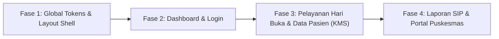

# Cetak Biru Redesign UI SIIP: Menghilangkan "AI Slop" Menjadi Antarmuka Kesehatan Klinis & Ramah Kader

Dokumen ini merupakan panduan lengkap redesign antarmuka seluruh halaman pada **SIIP (Sistem Informasi Posyandu)**. Tujuannya adalah merombak total tampilan yang bergaya "AI slop" (gradien neon sembarangan, kartu melayang dekoratif tanpa fungsi, animasi berlebihan, tipografi tidak konsisten) menjadi sistem antarmuka kesehatan yang **tenang, klinis, berwibawa, dan ramah bagi kader posyandu** di lapangan.

---

## 1. Memahami Masalah "AI Slop" pada Aplikasi Kesehatan

"AI slop" adalah istilah untuk pola desain seragam yang sering dihasilkan generator otomatis: terlihat mengilap pada pandangan pertama, tetapi miskin fungsi, melelahkan mata jika dipakai bekerja lama, dan tidak memahami konteks pengguna lapangan.

### Ciri-Ciri AI Slop yang Ditemukan di SIIP:
1. **Gradien Pelangi Tanpa Makna Klinis:** Kartu metrik dengan gradien hijau toska, biru elektrik, merah muda/fuchsia, dan hitam pekat berdampingan. Dalam aplikasi medis, warna harus membawa arti diagnostik (Normal, Waspada, Bahaya), bukan sekadar hiasan.
2. **Elemen Kosmetik Mengambang:** Lingkaran ikon panah di pojok kartu yang tidak jelas fungsinya, kartu melayang miring (*tilted 3D cards*) di halaman login, efek kabur (*blur-xl blobs*) di latar belakang, dan ikon gemerlap (*sparkles* ✨).
3. **Label & Chip Generik yang Mengacaukan Hierarki:** Chip kapital seperti `LIVE`, `TERPANTAU`, `PRIORITAS`, `MASUK APLIKASI`, dan `SISTEM AKTIF` yang memenuhi layar tanpa memberi nilai informasi tambahan.
4. **Tipografi Campur Aduk:** Angka statistik diacak antara font monospace dan font sans serif; penggunaan bobot font ekstrem (`font-black`, `font-extrabold`) di tempat yang tidak semestinya.
5. **Data Dummy yang Tidak Realistis:** Donut chart "100% Selesai", grafik batang dengan tinggi seragam, atau peringatan palsu seperti "25 dari 25 lansia perlu tindak lanjut" yang memicu *alert fatigue* (kader menjadi terbiasa mengabaikan peringatan penting).
6. **Animasi Berlebihan:** Angka berputar (*rolling numbers*) pada rekapan laporan resmi yang justru memperlambat kader membaca data saat membuat rekap ke Puskesmas.

---

## 2. Token Desain & Sistem Visual Bersama (Global Design System)

Seluruh halaman SIIP wajib mengacu pada sistem token yang konsisten:

### 2.1 Palet Warna Klinis (Clinical Palette)
| Token | Nilai Hex / Tailwind | Kegunaan |
|---|---|---|
| **Primary (Brand Medis)** | `#0F766E` (`teal-700`) | Aksi utama, link aktif, header tabel penting |
| **Primary Hover** | `#115E59` (`teal-800`) | Status hover & fokus aksi utama |
| **Primary Subtle** | `#F0FDFA` (`teal-50`) | Latar seleksi baris aktif, chip netral terpilih |
| **Page Background** | `#F8FAFC` (`slate-50`) | Latar belakang seluruh halaman aplikasi |
| **Surface (Card)** | `#FFFFFF` (`white`) | Permukaan kartu, panel, modal, dan tabel |
| **Border / Divider** | `#E2E8F0` (`slate-200`) | Garis pemisah 1px (jelas, tidak mengambang) |
| **Text Dark (Headings)** | `#0F172A` (`slate-900`) | Judul, angka metrik utama, label tebal |
| **Text Body** | `#334155` (`slate-700`) | Konten teks, nilai tabel (kontras WCAG AAA) |
| **Text Muted** | `#64748B` (`slate-500`) | Keterangan sekunder, satuan unit, helper text |

### 2.2 Warna Status Medis yang Terstandar
Warna status klinis **tidak boleh dijadikan latar belakang kartu raksasa**, melainkan hanya sebagai badge, aksen border 3px di tepi kiri, atau teks indikator:
- **Normal / Gizi Baik / Terkontrol:** Hijau Pinus (`#16A34A` / `emerald-600`), latar badge `#ECFDF5`.
- **Waspada / Gizi Kurang / Pra-Hipertensi / Garis Kuning:** Amber Terang (`#D97706` / `amber-600`), latar badge `#FFFBEB`.
- **Bahaya / Gizi Buruk / BGM / Hipertensi Tk. 2 / Stunting:** Merah Merjan (`#DC2626` / `red-600`), latar badge `#FEF2F2`.
- **Informatif / Rujukan Medis / Riwayat:** Biru Medis (`#2563EB` / `blue-600`), latar badge `#EFF6FF`.
> **Prinsip Aksesibilitas:** Semua status **wajib menyertakan teks atau simbol** bersama warnanya (misal: "● Normal", "▲ Gizi Kurang", "✕ Perlu Rujukan"), tidak boleh hanya mengandalkan warna saja.

### 2.3 Tipografi & Angka Tabular
- **Font Utama:** `Plus Jakarta Sans` atau `Inter` untuk seluruh antarmuka.
- **Angka Tabular (`font-variant-numeric: tabular-nums`):** Wajib diterapkan pada semua angka berat badan, tinggi badan, tensi darah, Z-score, dan jumlah peserta agar baris angka di tabel selalu sejajar vertikal dan nyaman dipindai.
- **Ukuran Minimum:** Teks isi minimal `14px` (`text-sm`), label minimum `12px` (`text-xs`). Hindari teks berukuran `8px`–`10px` karena sulit dibaca oleh kader senior di layar smartphone.
- **Penskalaan Teks (Accessibility Scaling):** Tersedia toggle ukuran huruf global (`100%`, `115%`, `130%`) di pengaturan yang mengubah `rem` dasar antarmuka.

### 2.4 Struktur Kartu, Radius, dan Bayangan
- **Radius:** Seragam `8px` (`rounded-lg`) hingga maksimal `12px` (`rounded-xl`). Hapus radius besar `24px`–`32px` yang membuat UI tampak seperti mainan anak-anak.
- **Bayangan:** Hindari bayangan lembut besar (`shadow-2xl`, `shadow-soft-card`). Gunakan bayangan datar tipis: `border border-slate-200/90 shadow-2xs` atau `shadow-xs`.
- **Informasi Density:** Tata letak harus padat dan efisien (*clinical density*), bukan spasi raksasa dengan ruang kosong yang memaksa kader terus-menerus melakukan scroll.

---

## 3. Redesign Rinci per Halaman & Modul

---

### Modul 1: Halaman Login & Reset Password (`/login`, `/reset-password`)

#### Masalah Saat Ini:
- Panel kiri menampilkan 3 kartu mengambang miring bertuliskan jargon generik ("Tercatat Rapi", "Grafik Otomatis", "Mudah Dipantau") di atas grid dekoratif AI.
- Headline berlebihan: *"Pencatatan Posyandu Kini Lebih Mudah & Cepat!"* dengan efek gradien warna-warni.
- Indikator palsu `SISTEM AKTIF` dan chip `MASUK APLIKASI`.
- Form terasa kecil dan tenggelam di antara hiasan latar.

#### Rekomendasi Redesign:
1. **Panel Kiri (Identitas & Kredibilitas Pelayanan):**
   - Ganti kartu melayang dengan **foto asli dokumentasi kader posyandu sedang menimbang balita atau melayani lansia** (atau ilustrasi datar bergaya editorial satu warna teal).
   - Tampilkan kutipan nilai konkret:
     > *"Sistem Informasi Pencatatan Tumbuh Kembang Balita & Skrining Lansia Terintegrasi Standar Antropometri Kemenkes RI & WHO."*
   - Sertakan badge resmi kredibilitas: Logo Posyandu / Kemenkes, info enkripsi data lokal, dan versi rilis aplikasi.
2. **Panel Kanan (Form Login yang Fokus & Ergonomis):**
   - Hapus chip `MASUK APLIKASI` dan tanda seru. Ganti dengan judul bersih: `Masuk ke SIIP` dan subjudul `Gunakan akun kader atau nomor registrasi Posyandu Anda.`
   - Kolom isian (Email/Username dan Password) memiliki tinggi minimal 44px dengan border tegas saat fokus (`ring-1 ring-teal-700`).
   - Tautan `Lupa Kata Sandi?` diletakkan sejajar di samping label `Kata Sandi`.
   - Tombol utama berwarna teal tua solid (`bg-teal-700 hover:bg-teal-800`), tanpa efek gradien.
   - Pesan error login ditampilkan dalam kotak peringatan jelas di bawah form, lengkap dengan instruksi bantuan jika lupa kata sandi.
3. **Halaman Reset Password:**
   - Hapus latar gradien pastel yang berlapis-lapis.
   - Gunakan kartu form tunggal terpusat di atas latar abu-abu muda (`#F8FAFC`).
   - Sediakan indikator syarat kata sandi yang konkret (minimal 8 karakter, ada kombinasi huruf dan angka) dengan tanda centang langsung saat mengetik.

---

### Modul 2: Layout Global, Navigasi Shell & Notifikasi (`app/page.tsx`)

#### Masalah Saat Ini:
- Header memiliki banner kuning peringatan periode yang sering terpotong dan terlalu mencolok.
- Notifikasi menggunakan interaksi geser kartu (*swipe gesture*) yang rentan salah klik saat menggunakan trackpad atau mouse desktop.
- Avatar profil kader menggunakan gradien warna-warni acak.

#### Rekomendasi Redesign:
1. **Sidebar Navigasi Desktop:**
   - Warna latar putih bersih dengan border kanan 1px `#E2E8F0`.
   - Item menu aktif diberi latar `#F0FDFA` (teal-50) dan teks teal tua (`#0F766E`) dengan garis vertikal 3px di sebelah kiri.
   - Menu dikelompokkan secara logis:
     - **Pelayanan Utama:** Dashboard, Hari Buka (Pelayanan), Data Balita, Data Lansia.
     - **Rekapitulasi:** Riwayat Pemeriksaan, Laporan Bulanan (SIP).
     - **Sistem:** Pengaturan Posyandu, Manajemen Akun Kader, Buku Saku/Bantuan.
2. **Topbar & Periode Aktif:**
   - Tampilkan identitas posyandu secara tegas di kiri atas: `Posyandu Melati 03 — RW 04, Kel. Sukamaju`.
   - **Pemilih Periode Sederhana:** Ganti banner kuning raksasa dengan pemilih dropdown kompak di header: `[ Periode: Oktober 2026 ▾ ]`. Jika periode belum dibuka, tampilkan badge abu-abu `Periode Ditutup` dan tombol `Buka Pelayanan`.
3. **Pusat Notifikasi (Notification Popover):**
   - Ganti sistem kartu geser (*swipe-to-delete*) dengan **daftar notifikasi terstruktur**:
     - Filter tab: `Semua`, `Perlu Rujukan (Klinis)`, `Sistem/Periode`.
     - Setiap item notifikasi menampilkan: Waktu pencatatan, nama pasien, ringkasan kondisi klinis (misal: *"Berat badan Kevin turun 2 bulan berturut-turut"*), dan tombol tautan langsung `Lihat Profil Pasien`.
     - Tombol `Tandai Semua Sudah Dibaca` dan `Hapus` diletakkan di bagian atas popover.
4. **Navigasi Bawah di Layar Ponsel (Mobile Bottom Bar):**
   - Sediakan navigasi bawah dengan 4 menu utama: `Dashboard`, `Pelayanan (Hari Buka)`, `Balita`, `Lansia`, serta menu drawer `Lainnya`.
   - Tombol `Pelayanan` di tengah dibuat sedikit lebih menonjol agar kader dapat langsung membuka meja pemeriksaan dengan satu ketukan ibu jari.

---

### Modul 3: Dashboard Overview (`features/dashboard/`)

#### Masalah Saat Ini:
- 4 kartu statistik gradien pelangi (hijau toska, biru ungu, merah muda, abu-abu hitam) dengan bulatan blur dekoratif.
- Angka acak memakai monospace ("2 Anak", "25 Lansia") sementara angka lain memakai font sans.
- Kader tidak tahu siapa orang yang harus ditindaklanjuti dari kartu tersebut.
- Donut chart "Aktivitas Kunjungan" menampilkan "100% Selesai" yang terkesan data palsu.

#### Rekomendasi Redesign:
1. **Grid Ringkasan Metrik (Action-Oriented Summary Cards):**
   - Semua kartu menggunakan latar putih yang seragam, border 1px abu-abu, dan tipografi sans tabular yang sama.
   - Warna status hanya hadir sebagai aksen garis border 3px di sisi kiri kartu:
     - **Kartu 1 (Balita Terdaftar):** Angka total balita, subteks perbandingan bulan lalu (misal: `38 Balita Aktif • 3 Bayi Baru Bulan Ini`).
     - **Kartu 2 (Kehadiran Hari Buka):** Angka persentase kehadiran riil periode berjalan (misal: `32 dari 38 Hadir [84%]`).
     - **Kartu 3 (Balita Perlu Perhatian Khusus):** Aksen border kiri merah jika angka > 0 (misal: `3 Balita Perlu Dipantau • 2 Tidak Naik BB, 1 Gizi Kurang`). Tombol klik langsung memfilter daftar anak.
     - **Kartu 4 (Skrining Lansia Berisiko PTM):** Aksen border kiri amber (misal: `5 Lansia Hipertensi Tk. 2 / GDS Tinggi`).
2. **Blok "Daftar Prioritas Hari Ini" (Komponen Baru yang Sangat Berguna):**
   - Tempatkan di bawah kartu metrik: daftar ringkas berisi nama-nama warga yang membutuhkan perhatian darurat kader.
   - Kolom: Nama Pasien, Usia, Kategori (Balita/Lansia), Alasan Perhatian (contoh: *"BB tidak naik 2 bulan (2T)"*, *"Tensi 170/100 mmHg"*, *"Belum pernah hadir 3 bulan berturut-turut"*), dan tombol aksi cepat `Buka Data`.
3. **Grafik Status Gizi & Pertumbuhan Bulanan:**
   - Ganti grafik batang hijau yang seragam dengan **Grafik Tren Status Gizi Agregat**:
     - Garis/Area bertumpuk menunjukkan proporsi: Gizi Baik (Hijau), Berisiko/Kurang (Kuning), Gizi Buruk/Stunting (Merah) dari bulan ke bulan.
     - Sumbu Y memiliki angka pasti (jumlah balita), sumbu X menampilkan nama bulan dengan jelas.
     - Mode tampilan kosong (*empty state*) yang manusiawi: jika data bulan tertentu kosong, tampilkan *"Belum ada penimbangan pada bulan ini"* alih-alih grafik kosong yang rusak.
4. **Cakupan Kunjungan & Distribusi Wilayah (RT/RW):**
   - Ganti donut chart dummy dengan **Progress Bar Target vs Capaian**:
     - Bar Balita: `32/38 anak ditimbang (84%)` dengan bar hijau teal.
     - Bar Lansia: `24/30 lansia diperiksa (80%)` dengan bar biru medis.
   - **Tabel Kehadiran per RT/RW:** Menampilkan tingkat partisipasi tiap wilayah RT agar kader mengetahui RT mana yang perlu dikunjungi secara jemput bola (*door-to-door*).

---

### Modul 4: Pelayanan Hari Buka Posyandu (`features/pelayanan/`)

#### Masalah Saat Ini:
- Form input pemeriksaan bercampur antara data medis dan kontrol navigasi.
- Tampilan antrean pasien di sebelah kiri kurang memanfaatkan ruang horizontal.
- Feedback status gizi Z-Score terlihat seperti pesan error form alih-alih hasil diagnosa klinis.
- Jika koneksi terputus saat kader mencatat penimbangan di posyandu, data rentan hilang.

#### Rekomendasi Redesign:
1. **Tata Letak Meja Pelayanan (2 Kolom Fungsional):**
   - **Kolom Kiri (Antrean & Pencarian Cepat):**
     - Tab cepat: `Balita` dan `Lansia`.
     - Filter status antrean: `Belum Diperiksa (22)` dan `Selesai Hari Ini (16)`.
     - Input pencarian cepat dengan autofocus: cari instan berdasarkan nama anak/ibu atau NIK.
     - Tombol `+ Pasien Baru` tepat di atas daftar antrean untuk mendaftarkan warga yang baru pertama kali datang tanpa harus pindah modul.
   - **Kolom Kanan (Formulir Pemeriksaan Aktif):**
     - **Header Pasien Terpilih:** Tampilkan nama, tanggal lahir, usia dalam bulan (dihitung otomatis per tanggal hari ini), nama orang tua, dan riwayat BB bulan sebelumnya sebagai pembanding langsung.
2. **Formulir Pemeriksaan Balita yang Ergonomis:**
   - **Input Antropometri:** Berat Badan (kg), Tinggi/Panjang Badan (cm), Lingkar Kepala (cm), Lingkar Lengan Atas (LiLA).
   - Mode input angka besar ramah sentuhan keyboard numerik HP/tablet.
   - **Panel Hasil Otomatis Z-Score (Live Assessment):**
     - Langsung muncul saat BB dan TB diisi, disajikan dalam kartu hasil klinis yang tenang:
       - `BB/U: Gizi Baik (Z-score: -0.42)` [Badge Hijau]
       - `TB/U: Normal (Z-score: +0.20)` [Badge Hijau]
       - `BB/TB: Gizi Baik (Z-score: -0.15)` [Badge Hijau]
       - `Pertumbuhan: Naik (N) (+300 gram dari bulan lalu)`
   - **Checklist Intervensi & Suplementasi:**
     - Toggle tombol yang jelas: `Vitamin A (Kapsul Biru/Merah)`, `Obat Cacing`, `ASI Eksklusif (0-6 bln)`, `Imunisasi Tambahan`, `Pemberian Makanan Tambahan (PMT)`.
3. **Formulir Skrining Lansia:**
   - Kolom pemeriksaan vital: Tekanan Darah (Sistol / Diastol mmHg), Gula Darah Sewaktu (mg/dL), Kolesterol, Asam Urat, Lingkar Perut (cm).
   - Indikator otomatis JNC-7 / Perki: Misal Sistol 155 -> langsung menampilkan badge kuning `Hipertensi Derajat 1` dengan anjuran edukasi gaya hidup / rujukan Puskesmas.
   - Catatan keluhan kesehatan dan tindakan/konseling kader.
4. **Penyelamatan Data Lokal (Draft Auto-Save & Offline Resilience):**
   - Tampilkan indikator penyimpanan halus di sudut formulir: `✓ Tersimpan di memori perangkat (aman jika internet terputus)`.
   - Tombol utama: `Simpan Pemeriksaan` (warna hijau teal solid) dan tombol `Simpan & Lanjut ke Pasien Berikutnya`.
5. **Tabel Log Sesi Hari Buka:**
   - Terletak di bawah form: ringkasan siapa saja yang telah diperiksa pada sesi hari ini dengan tombol cetak bukti periksa atau edit data jika ada kesalahan ketik timbangan.

---

### Modul 5: Modul Data Balita (`features/balita/`)

#### Masalah Saat Ini:
- Grafik tumbuh kembang pada detail balita adalah grafik garis generik (hanya garis biru dan hijau) tanpa kurva persentil atau pita standar WHO KMS.
- Tabel daftar balita memiliki terlalu banyak kolom yang terpotong di layar kecil.

#### Rekomendasi Redesign:
1. **Daftar Balita (`BalitaListTable.tsx`):**
   - Header tabel yang bersih: `Nama Balita`, `NIK / No. KIA`, `Usia (Bulan)`, `Nama Ibu`, `BB/TB Terakhir`, `Status Gizi Terkini`, `Aksi`.
   - Filter cepat menurut kelompok usia balita: `Semua`, `0–5 Bulan (ASI Eksklusif)`, `6–23 Bulan (Baduta / MP-ASI)`, `24–59 Bulan`.
   - Filter menurut status gizi: `Semua`, `Perlu Perhatian (2T/BGM/Stunting)`, `Normal`.
   - Pada layar smartphone: Tabel berganti menjadi **kartu daftar klinis kompak** yang menampilkan nama anak, usia, nama ibu, dan badge status gizi dengan tombol aksi detail.
2. **Form Tambah / Edit Balita (`BalitaAddForm.tsx`):**
   - Pengelompokan field dengan judul section yang jelas:
     - **Identitas Anak:** Nama Lengkap, NIK, No. Kartu Keluarga, Tanggal Lahir, Jenis Kelamin, Anak ke-berapa.
     - **Riwayat Kelahiran:** Berat Lahir (BBLR jika < 2500g), Panjang Lahir, Kepemilikan Buku KIA (Wajib/Tidak).
     - **Data Orang Tua & Domisili:** Nama Ibu, NIK Ibu, Nama Ayah, Nomor WhatsApp Aktif, RT / RW, Alamat Lengkap.
3. **Detail Rekam Medis Balita (`BalitaDetailView.tsx`):**
   - **Ringkasan Header Pasien:** Profil anak dengan usia bulan akurat, status gizi per pemeriksaan terakhir, dan peringatan jika berat badan balita tidak naik 2 bulan beruntun.
   - **Grafik Tumbuh Kembang Gaya KMS Asli (Kemenkes & Standar WHO):**
     - Sumbu X: Usia dalam bulan (0 hingga 60 bulan).
     - Sumbu Y: Berat Badan (kg) atau Tinggi Badan (cm).
     - Latar grafik berupa **Pita Warna Standar KMS**:
       - *Pita Merah Bawah:* Bawah Garis Merah (BGM / Gizi Buruk, < -3 SD).
       - *Pita Kuning Bawah:* Gizi Kurang (-3 SD s/d -2 SD).
       - *Pita Hijau:* Gizi Baik / Normal (-2 SD s/d +1 SD).
       - *Pita Kuning Atas:* Risiko Berat Badan Lebih (> +1 SD s/d +2 SD).
     - Plotting titik data riil balita dihubungkan garis tegas dengan penanda Naik (N) atau Tidak Naik (T) di setiap titik kunjungan.
   - **Tabel Riwayat Bulanan Balita:**
     - Menampilkan rekam jejak lengkap: Tanggal, Usia Bulan, BB, TB, LKA, LiLA, Status BB/U, Status TB/U, Status BB/TB, Pemberian Vitamin A, Obat Cacing, dan PMT.
     - Tombol cetak Kartu Menuju Sehat (KMS) digital dalam format PDF untuk disimpan orang tua.

---

### Modul 6: Modul Data Lansia (`features/lansia/`)

#### Masalah Saat Ini:
- Tampilan menyamakan profil lansia dengan balita tanpa memperhitungkan faktor penyakit tidak menular (PTM) yang khas pada lansia.
- Kurangnya visualisasi batas normal tekanan darah dan gula darah.

#### Rekomendasi Redesign:
1. **Daftar Lansia (`LansiaListTable.tsx`):**
   - Kolom utama: `Nama Lansia`, `NIK`, `Usia (Tahun)`, `RT/RW`, `Tekanan Darah Terakhir`, `Gula Darah Terakhir`, `Status Risiko PTM`.
   - Filter cepat: `Semua`, `Pra-Lansia (45-59 th)`, `Lansia (60-69 th)`, `Lansia Risiko Tinggi (>= 70 th)`.
   - Filter faktor risiko: `Hipertensi`, `Diabetes Melitus`, `Normal`.
2. **Detail Pasien Lansia (`LansiaDetailView.tsx`):**
   - **Header Profil:** Menampilkan identitas, nomor kontak keluarga/pendamping, status BPJS/KIS, dan daftar alergi/riwayat penyakit terdahulu.
   - **Grafik Tren Pemantauan Parameter Vital (Vital Signs Chart):**
     - Grafik Tekanan Darah: Plotting sistol dan diastol sepanjang waktu, dilengkapi garis batas referensi putus-putus merah pada `140 mmHg` (batas hipertensi sistolik).
     - Grafik Gula Darah Sewaktu & Asam Urat: Dilengkapi garis batas normal klinis agar kader dan keluarga lansia bisa langsung melihat tren kestabilan gula darah.
   - **Histori Keluhan & Rujukan:** Tabel catatan keluhan fisik yang sering dialami lansia (pusing, nyeri sendi, sesak napas) dan riwayat rujukan ke Puskesmas.

---

### Modul 7: Modul Riwayat Pemeriksaan & Slip Cetak (`features/riwayat/`)

#### Masalah Saat Ini:
- Filter riwayat berantakan dan lambat memuat data.
- Detail riwayat menggunakan modal dengan kartu gradien di dalamnya (`bg-gradient-to-r from-teal-500/10`).

#### Rekomendasi Redesign:
1. **Bilah Filter Multi-Parameter yang Rapi:**
   - Filter bar kompak satu baris: Pilihan Kategori (`Semua`, `Balita`, `Lansia`), Pilihan Periode Bulan & Tahun, Filter Status Gizi/Kesehatan, dan Kotak Pencarian Pasien.
   - Tidak ada tombol "Cari" manual yang lambat; pencarian menggunakan in-memory search instan dengan debounce 150ms.
2. **Tabel Riwayat Klinis:**
   - Baris tabel bersih dengan zebra-striping lembut (`hover:bg-slate-50`).
   - Angka ukuran tubuh dan tensi diformat menggunakan font angka tabular.
   - Tombol aksi cepat: `Lihat Detail`, `Cetak Lembar Hasil`, `Koreksi Data`.
3. **Modal Detail & Cetak Lembar Hasil Pemeriksaan:**
   - Hapus latar gradien dekoratif.
   - Format modal didesain menyerupai **Lembar Bukti Pemeriksaan Posyandu Resmi**:
     - Kop surat: Nama Posyandu, Desa/Kelurahan, Tanggal Pemeriksaan, Nama Kader Pemeriksa.
     - Identitas pasien dan hasil pengukuran lengkap.
     - Kotak saran kader / anjuran gizi keluarga.
     - Tombol cetak langsung ke printer termal / kertas A5 untuk dibawa pulang oleh warga.

---

### Modul 8: Modul Laporan Bulanan (SIP - Sistem Informasi Posyandu) (`features/laporan/`)

#### Masalah Saat Ini:
- Terdapat komponen animasi angka berputar (`AnimatedNumber`) yang memperlambat kader menyalin data resmi ke format laporan fisik Puskesmas.
- Struktur laporan tidak sepenuhnya mengikuti indikator baku SKDN Posyandu Kementerian Kesehatan.

#### Rekomendasi Redesign:
1. **Rekapan Balita Berstandar SKDN Kemenkes RI:**
   - Sajikan tabel ringkasan indikator standar Posyandu:
     - **S (Sasaran):** Jumlah seluruh balita di wilayah kerja Posyandu.
     - **K (KMS):** Jumlah balita yang memiliki KMS / Buku KIA.
     - **D (Ditimbang):** Jumlah balita yang hadir dan ditimbang pada bulan laporan.
     - **N (Naik):** Jumlah balita yang berat badannya naik sesuai kurva pertumbuhan.
     - **T (Tidak Naik):** Balita yang timbangannya tetap atau turun (perlu intervensi kader).
     - **2T (Dua Kali Tidak Naik):** Balita risiko tinggi gagal tumbuh (wajib rujukan Puskesmas).
     - **BGM (Bawah Garis Merah):** Jumlah balita dengan berat di bawah garis merah.
   - Tampilkan persentase keberhasilan program: `% D/S (Tingkat Partisipasi)` dan `% N/D (Tingkat Keberhasilan Penimbangan)`.
2. **Daftar "Balita & Lansia Perlu Perhatian Khusus" (Export Ready):**
   - Tabel khusus balita gizi kurang/buruk dan lansia tensi tinggi yang siap diserahkan kepada Bidan Desa atau Petugas Gizi Puskesmas untuk verifikasi lapangan.
3. **Ekspor Excel & Cetak PDF Resmi:**
   - Tombol `Unduh Rekap Excel (.xlsx)` yang menghasilkan format tabel matriks sesuai formulir SIP Kemendagri / Kemenkes tanpa formatting rusak.
   - Tombol `Cetak Laporan Bulanan (PDF)` dengan tata letak rapi, margin halaman standar A4, dan kolom tanda tangan Ketua Posyandu serta Bidan Desa.

---

### Modul 9: Modul Pengaturan & Manajemen Kader (`features/pengaturan/`)

#### Masalah Saat Ini:
- Terdapat kartu pengaturan dengan gradien ungu-violet (`from-violet-50/60 to-indigo-50/40`) yang tidak selaras dengan tema aplikasi.
- Opsi penskalaan teks belum terintegrasi menyeluruh ke setiap komponen.

#### Rekomendasi Redesign:
1. **Profil Posyandu & Wilayah Kerja:**
   - Form data posyandu: Nama Posyandu, Nomor Registrasi Posyandu, Alamat Balai Posyandu, RT/RW binaan, Desa/Kelurahan, Kecamatan, Puskesmas Pembina, dan Nama Bidan Desa penanggung jawab.
2. **Manajemen Akun Kader Posyandu:**
   - Daftar kader yang bertugas, peran (`Ketua Posyandu`, `Kader Penimbang`, `Kader Pencatat`), status keaktifan akun, dan tombol reset password yang mudah dikelola ketua posyandu.
3. **Pengaturan Aksesibilitas (Ramah Kader Lansia):**
   - Pilihan Ukuran Huruf: `Standar (100%)`, `Besar (115%)`, `Sangat Besar (130%)`.
   - Toggle Kontras Tinggi: Mempertegas border tabel dan teks menjadi hitam pekat agar nyaman digunakan di ruangan posyandu yang silau atau minim cahaya.

---

### Modul 10: Modul Buku Saku Digital & Bantuan Kader (`features/bantuan/`)

#### Masalah Saat Ini:
- Memakai ikon dekoratif `Sparkles ✨` seperti aplikasi asisten AI konsumen.
- Panduan disajikan sebagai teks panjang tanpa panduan visual langkah kerja posyandu.

#### Rekomendasi Redesign:
1. **Konsep: "Buku Saku Digital Kader Posyandu":**
   - Hapus ikon *sparkles* dan istilah AI. Ganti dengan ikon buku medis, timbangan, dan pita ukur yang profesional.
2. **SOP 5 Meja Posyandu:**
   - Panduan alur kerja 5 meja: Pendaftaran, Penimbangan/Pengukuran, Pencatatan KIA, Penyuluhan Gizi, dan Pelayanan Kesehatan/Imunisasi.
3. **Panduan Pengukuran Antropometri yang Benar (Sesuai Kemenkes):**
   - Perbedaan cara ukur panjang badan telentang (balita < 24 bulan) vs tinggi badan berdiri (anak >= 24 bulan dengan mikrotoise).
   - Cara membaca Z-Score WHO dan langkah penanganan awal balita 2T (tidak naik berat badan dua kali).
4. **FAQ Kendala Teknis Posyandu:**
   - Panduan solusi cepat jika kuota internet habis saat pelayanan, cara mengedit data yang salah input, dan cara menambah bayi baru lahir.

---

### Modul 11: Portal Puskesmas & Pengawasan Wilayah (`app/puskesmas/`, `app/publik/`)

#### Masalah Saat Ini:
- Tampilan publik belum membedakan data privasi individu warga dan data agregat posyandu.
- Filter antar posyandu kurang menonjolkan perbandingan performa kesehatan masyarakat.

#### Rekomendasi Redesign:
1. **Dashboard Agregat Pembina Kesehatan (Puskesmas / Kelurahan):**
   - Header wilayah kerja: Menampilkan nama Puskesmas dan daftar seluruh Posyandu binaan.
   - Metrik Komposit: Total sasaran balita di kelurahan, rata-rata cakupan penimbangan (D/S), prevalensi balita stunting di wilayah kerja, dan jumlah rujukan lansia.
2. **Grafik Komparasi Antar Posyandu:**
   - Grafik batang perbandingan tingkat partisipasi (% D/S) Posyandu A, B, C untuk memetakan posyandu mana yang membutuhkan pembinaan tambahan.
3. **Perlindungan Privasi Data Warga (Kepatuhan UU PDP):**
   - Pada halaman publik atau pengawasan umum, NIK warga wajib di-masking secara otomatis (contoh: `320104********0001`), dan nomor telepon orang tua disembunyikan untuk menjaga privasi warga.

---

## 4. Matriks Perbandingan: Desain Lama ("AI Slop") vs Desain Baru ("Klinis Tenang")

| Aspek Desain | Desain Lama ("AI Slop") | Desain Baru ("Klinis & Ramah Kader") |
|---|---|---|
| **Palet Warna** | Gradien toska, biru elektrik, merah muda, ungu, hitam | Satu warna utama (Teal Tua `#0F766E`), latar abu-abu muda (`#F8FAFC`), putih bersih |
| **Arti Warna** | Warna-warni dekoratif pada kartu dan teks | Warna hanya untuk status klinis (Hijau=Normal, Kuning=Waspada, Merah=Bahaya) |
| **Sudut & Bayangan** | Radius `24px`–`32px`, bayangan lembut besar `blur-xl` | Radius `8px`–`12px`, border tipis 1px `#E2E8F0`, tanpa bayangan mengambang |
| **Tipografi** | Angka acak campur sans & monospace, `font-black` | Sans humanis tunggal (`Plus Jakarta Sans`), angka tabular (`tabular-nums`), minimal 14px |
| **Kartu Statistik** | Angka besar + chip `LIVE` / `PRIORITAS` + panah mengambang | Ringkasan netral + subteks aksi + link langsung ke daftar pasien |
| **Grafik Balita** | Bar chart batang hijau seragam atau line chart biasa | Grafik Tumbuh Kembang gaya KMS dengan pita warna persentil WHO (SD -3 s/d +3) |
| **Grafik Lansia** | Line chart polos tanpa indikator normal | Garis tensi & gula darah dengan batas acuan putus-putus merah klinis |
| **Karakter Teks** | Tagline generik dengan tanda seru (*"Mudah & Cepat!"*) | Ringkas, jelas, bahasa operasional posyandu Indonesia yang bersahabat |
| **Aksesibilitas** | Target sentuh kecil, teks abu-abu pudar di atas putih | Target sentuh min 44px, kontras tinggi WCAG AAA, opsi font besar untuk kader senior |
| **Keamanan Data** | Latar login dipenuhi kartu melayang dekoratif | Penegasan kepatuhan standar antropometri Kemenkes RI, logo resmi, masking NIK |

---

## 5. Rencana & Urutan Pengerjaan Implementasi

Agar proses redesign berjalan terarah dan tidak mengganggu alur kerja yang sudah berjalan, implementasi dibagi ke dalam 4 fase:

1. **Fase 1: Standardisasi Token Global & Layout Shell**
   - Buat file konfigurasi token warna, font sans tabular, dan border di CSS/Tailwind.
   - Bersihkan `app/page.tsx` dari banner kuning raksasa, ganti dengan pemilih periode sederhana di topbar.
   - Sederhanakan navigasi sidebar desktop dan mobile bottom navigation.
2. **Fase 2: Redesign Halaman Login, Reset Password, dan Dashboard Overview**
   - Hapus panel kartu melayang di `login/page.tsx`, ganti dengan identitas resmi posyandu dan kredibilitas data.
   - Rombak `DashboardKpiGrid.tsx` menjadi 4 kartu ringkasan netral tanpa gradien warna-warni.
   - Tambahkan blok *"Prioritas Hari Ini"* di `DashboardModule.tsx` berisi nama anak/lansia yang butuh tindakan segera.
   - Ganti grafik dummy dengan grafik tren status gizi dan progress bar kehadiran.
3. **Fase 3: Optimalisasi Meja Pelayanan Hari Buka & Rekam Medis (KMS)**
   - Rombak `PelayananModule.tsx` menjadi meja kerja 2 kolom yang fokus dan cepat untuk hari buka posyandu.
   - Buat kurva pertumbuhan gaya KMS asli dengan pita warna Z-Score WHO di `BalitaDetailView.tsx`.
   - Tambahkan garis batas tensi klinis pada detail pemantauan lansia di `LansiaDetailView.tsx`.
4. **Fase 4: Rekapitulasi Laporan SIP & Pengawasan Puskesmas**
   - Rapikan `LaporanModule.tsx` dengan format SKDN Kemenkes, hilangkan efek animasi angka berputar.
   - Perbaiki format ekspor Excel dan cetak PDF agar rapi di kertas A4.
   - Terapkan masking NIK pada modul publik dan portal Puskesmas.

---

## 6. Prompt Instruksi Cepat untuk Eksekusi Coding AI

Gunakan prompt di bawah ini saat meminta asisten AI mengimplementasikan perubahan pada modul tertentu:

> *"Lakukan redesign pada komponen [Nama Komponen] agar menghilangkan gaya visual 'AI slop' dan mengadopsi standar antarmuka kesehatan yang tenang, klinis, dan ramah kader posyandu. Hapus semua latar gradien warna-warni, efek blur-xl dekoratif, chip 'LIVE'/'PRIORITAS', dan radius besar. Gunakan palet utama teal tua (#0F766E), latar slate-50 (#F8FAFC), border 1px slate-200 (#E2E8F0), radius 8–12px, serta font sans dengan tabular-nums pada setiap angka. Warna merah/kuning/hijau hanya digunakan untuk status klinis dan selalu disertai label teks. Pastikan ukuran target tombol minimal 44px agar ramah sentuhan layar HP, dan data disajikan secara padat, jelas, serta berorientasi tindakan kader di lapangan."*